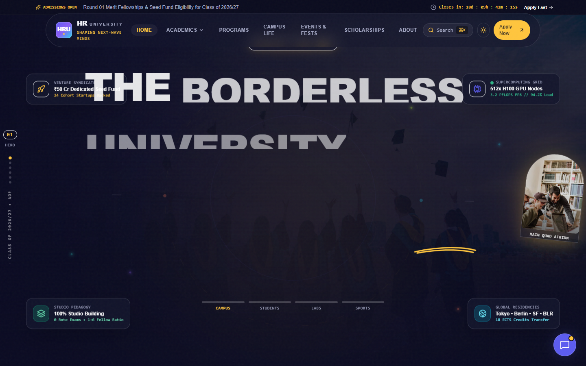
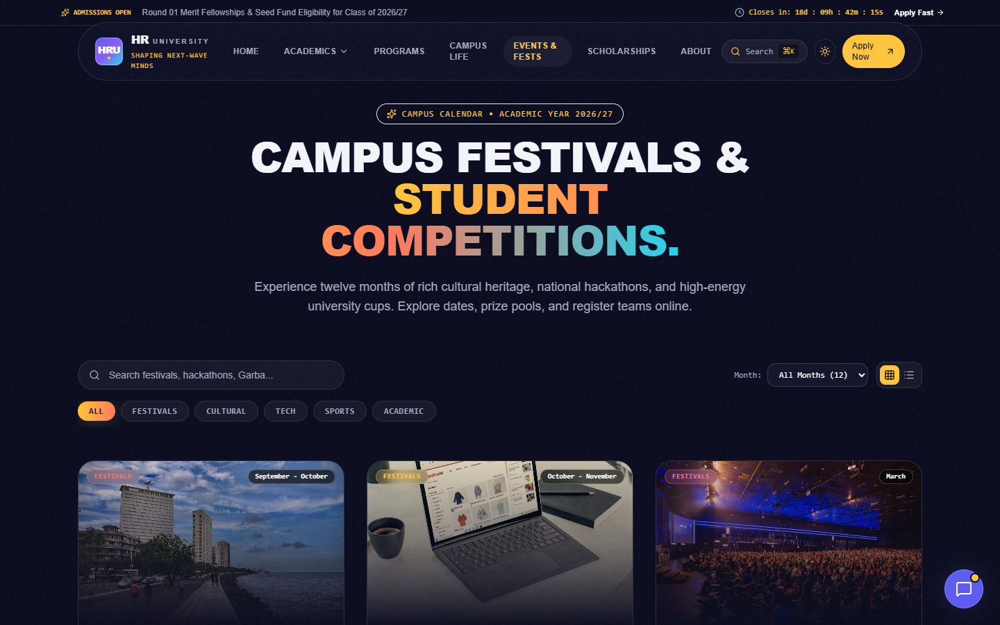
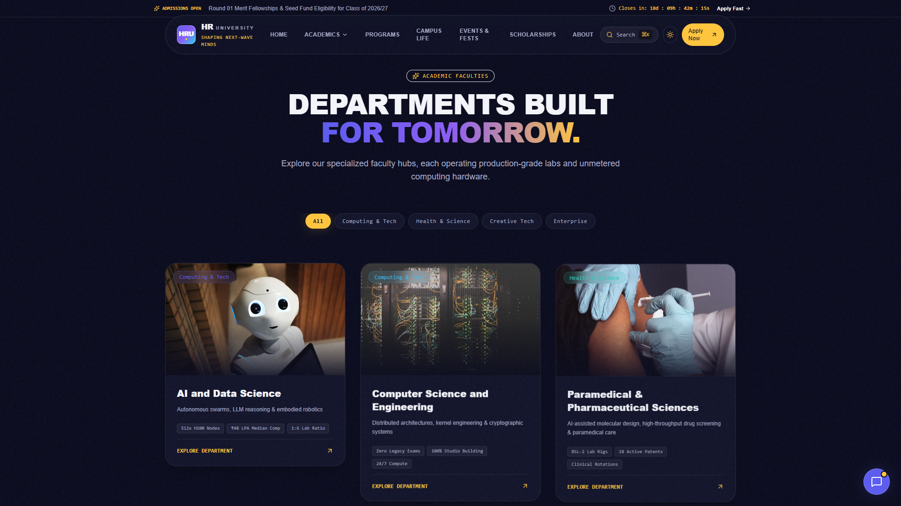
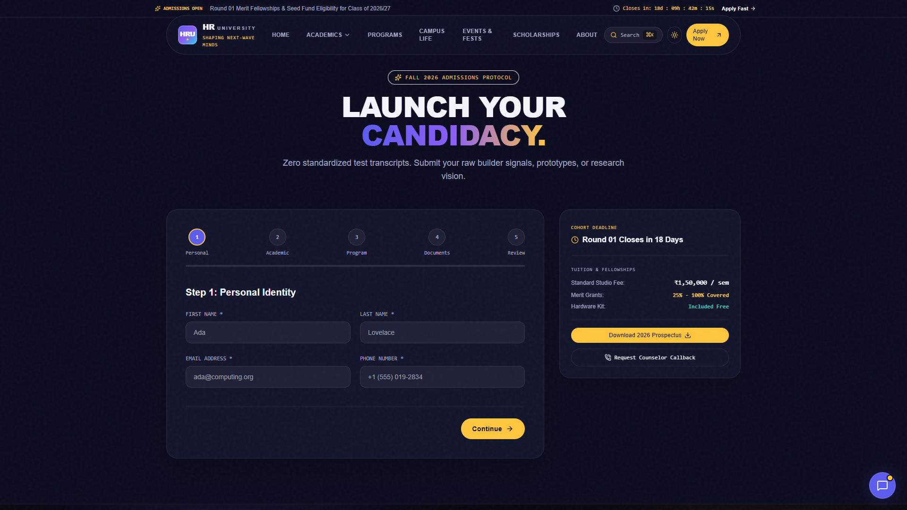

# HR University (HRU) — Official Web Portal

> **HR University (HRU)** is an institution dedicated to cutting-edge research, interdisciplinary technology, and transformative higher education. This repository contains the complete frontend web portal and interactive user interface.

[](https://react.dev/)
[](https://vitejs.dev/)
[](https://tailwindcss.com/)
[](./LICENSE)
[]()

---

## 🏛️ Project Overview

The HR University web portal delivers a modern, high-performance, and immersive campus experience for prospective students, faculty, recruiters, and alumni. Built with React and styled using Tailwind CSS and Framer Motion, it balances smooth animations with fast load times and clean responsiveness across mobile, tablet, and ultra-wide screens.

---

## ✨ Key Features

- **Cinematic Animated Intro & Hero**: Dynamic video backdrop with fallback visuals, customizable intro screen sequence, and smooth entrance transitions powered by Framer Motion.
- **Live Dynamic Counters & Stats**: Animated real-time metrics for campus enrollment, faculty-to-student ratios, patent filings, research grants, and placement rates.
- **Interactive Admissions & Eligibility**: Step-by-step admissions application form with field validation, scholarship calculators, fee structures, and application deadline timelines.
- **Academic Programs & Departments**: In-depth department showcases covering Artificial Intelligence, Computer Science & Systems, Paramedical & Pharmaceutical Sciences, Sports Science & Biomechanics, Architecture, and Business & Venture Strategy.
- **Campus Life & Virtual Tour**: Interactive campus facilities explorer highlighting research supercomputing clusters, aeroponic biodomes, makerspaces, esports arenas, and student libraries.
- **Events & Festival Calendar**: Comprehensive cultural, technical, and sports calendar (Navratri Garba Raas, HackHRU Hackathon, Diwali Deepotsav, HRU Fest, Academic Conclaves) with dedicated event detail views and filterable categories.
- **Placements & Recruiter Network**: Transparent placement statistics, tier-1 recruiting partner directories, student package percentiles, and recruiter enquiry flows.
- **Student Portal & Academic Updates**: Real-time notifications for timetable releases, exam admit cards, SLURM cluster credentials, and academic results.
- **Accessible & Responsive**: Fully responsive layout with custom toast alerts, interactive modal lightboxes, and keyboard navigation.

---

## 🛠️ Tech Stack

- **Framework**: [React 18](https://react.dev/) (Single Page Application with React Router v7)
- **Build Tool**: [Vite 8](https://vitejs.dev/)
- **Styling**: [Tailwind CSS 3](https://tailwindcss.com/) with custom brand design tokens & dark-first color schemes
- **Animation & Transitions**: [Framer Motion](https://www.framer.com/motion/), [GSAP](https://gsap.com/), and [Lenis](https://lenis.darkroom.engineering/) smooth scroll
- **Icons**: [Lucide React](https://lucide.dev/)
- **Micro-Interactions**: [Canvas Confetti](https://www.npmjs.com/package/canvas-confetti)
- **Linter & Code Quality**: [Oxlint](https://oxc.rs/)

---

## 📂 Project Structure

```text
hr-university/
├── public/                 # Static assets (favicons, SVG icons, event photography)
│   ├── favicon.svg
│   ├── icons.svg
│   └── images/events/      # Public-domain & verified CC-licensed event images
├── src/
│   ├── assets/             # Branding assets, vector doodles, and icons
│   ├── components/         # Modular, reusable UI components
│   │   ├── common/         # Buttons, badges, cards, toasts, lightboxes
│   │   ├── layout/         # Navigation bar, mobile drawer, footer
│   │   ├── placements/     # Placement metrics, recruiter cards
│   │   ├── student/        # Student portal dashboard & notification widgets
│   │   └── ui/             # Headings, animated counters, motion wrappers
│   ├── config/             # Navigation links, academic calendars, portal config
│   ├── data/               # University structured data (departments, events, placements)
│   ├── lib/                # Motion presets, animation helpers, utility functions
│   ├── pages/              # Routed page views (Home, Admissions, Departments, Events, etc.)
│   ├── sections/           # Modular landing page sections (Hero, Stats, Research, Life)
│   ├── services/           # API integration stubs (ready for backend connection)
│   ├── styles/             # Global CSS and custom design tokens
│   ├── App.jsx             # Main router configuration & layout scaffold
│   └── main.jsx            # React root mount point
├── .env.example            # Environment configuration template
├── .gitignore              # Ignored files (node_modules, build artifacts, secrets)
├── package.json            # Project dependencies and script definitions
├── tailwind.config.js      # Tailwind CSS theme configuration
├── vite.config.js          # Vite build and development configuration
├── LICENSE                 # Proprietary source-available license
├── CREDITS.md              # Image and media attribution registry
└── README.md               # Repository documentation
```

---

## 🚀 Getting Started

Follow these steps to run the HR University frontend locally:

### 1. Prerequisites

Ensure you have [Node.js](https://nodejs.org/) (v18.0.0 or higher recommended) and `npm` installed.

```bash
node --version
npm --version
```

### 2. Installation

Clone the repository and install all required dependencies:

```bash
git clone https://github.com/fenilrami27/hr-university-website.git
cd hr-university-website
npm install
```

### 3. Environment Setup (Optional)

Copy the sample environment file to activate optional student demo fixtures:

```bash
cp .env.example .env
```

| Variable | Default | Purpose |
| :--- | :--- | :--- |
| `VITE_USE_DEMO_DATA` | `false` | When `true`, populates the student portal with demo academic records |

### 4. Run Development Server

Start the local Vite development server:

```bash
npm run dev
```

Open your browser at `http://localhost:5173` (or `http://localhost:5174`).

### 5. Production Build

To generate an optimized production bundle:

```bash
npm run build
```

Preview the production build locally:

```bash
npm run preview
```

---

## 📸 Screenshots

<!-- Place UI screenshots in qa/screenshots or assets/screenshots and link them below -->

| Landing Page & Hero | Events & Festivals |
| :---: | :---: |
|  |  |

| Academic Departments | Admissions Portal |
| :---: | :---: |
|  |  |

---

## 🗺️ Roadmap

- [x] **Phase 1: Frontend UI Architecture** — Responsive landing page, animated hero, interactive departments, events catalog, dynamic stat counters.
- [x] **Phase 2: Academic & Student Portals** — Admissions eligibility checker, student notices feed, virtual tour.
- [ ] **Phase 3: Backend Services (Coming Soon)**:
  - Centralized REST/GraphQL API for dynamic event registrations and updates.
  - Secure student authentication and role-based access control (RBAC).
  - Admissions application processing pipeline and document uploads.
  - Placement recruitment partner management and interview scheduler.
  - Real-time notification webhooks for timetable and exam results.

---

## 📄 License & Attribution

Copyright © 2026 **Wings Women's Foundation**. All Rights Reserved.

This project is made publicly viewable for demonstration, inspection, and portfolio purposes. No distribution, commercial reproduction, or unauthorized duplication is allowed. See [`LICENSE`](./LICENSE) for terms.

Media and photo attributions are listed in [`CREDITS.md`](./CREDITS.md) and [`IMAGE_CREDITS.md`](./IMAGE_CREDITS.md).
